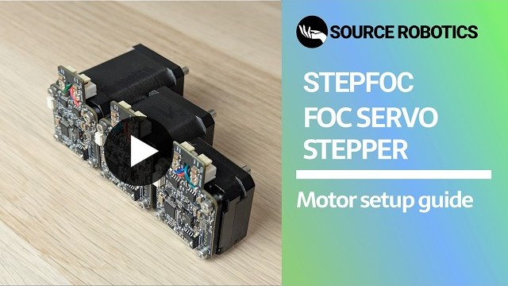

  

<h1 align="center">STEPFOC</h1>

  <b>FOC driver that turns stepper motors into closed-loop servos, with open-source firmware.</b> 
  It never loses steps, reports its position and takes position, speed, torque or impedance commands.

  <a href="https://source-robotics.com/products/stepfoc-stepper-controller"><b>Buy</b></a>&nbsp;&nbsp;·&nbsp;&nbsp;
  <a href="https://docs.source-robotics.com/STEPFOC-docs/"><b>Documentation</b></a>&nbsp;&nbsp;·&nbsp;&nbsp;
  <a href="https://docs.source-robotics.com/STEPFOC-docs/latest/quick-start/"><b>Quick start</b></a>&nbsp;&nbsp;·&nbsp;&nbsp;
  <a href="https://github.com/Source-Robotics/STEPFOC-stepper-controller/releases/latest"><b>Download</b></a>&nbsp;&nbsp;·&nbsp;&nbsp;
  <a href="https://discord.com/invite/prjUvjmGpZ"><b>Discord</b></a>

  
  
  

| **12 to 29 V** | **1.5 A** | **14-bit** | **CAN + UART** | **39 × 39 mm** |
|:-:|:-:|:-:|:-:|:-:|
| supply voltage | motor current, 2.8 A max | encoder | interfaces | NEMA 17 size, 8 g |

## Project overview

<table>
  <tr>
    <td width="55%" valign="middle">
      <b>STEPFOC</b> is a FOC-based stepper motor controller designed to deliver affordable, high-performance hardware
      paired with powerful open-source software. Its mission is to transform low-cost stepper motors into
      high-performance robotic servos, enabling advanced robotics applications without the high price tag.
        
      The controller features a 14-bit magnetic encoder, inline current sensing, CAN and UART interfaces, and
      supports position, velocity, torque and impedance control modes. It is made for NEMA 17 motors and also fits
      NEMA 23 (with the NEMA 23 spacer) and other frames such as NEMA 14 (with an adapter).
        
      <a href="https://youtu.be/60UMc95H8iE"><b>&#9654;&#xFE0E;&nbsp; Watch the STEPFOC motor setup guide</b></a>
    </td>
    <td width="45%" valign="middle">
      
    </td>
  </tr>
</table>

STEPFOC and the [Spectral Micro BLDC driver](https://docs.source-robotics.com/Spectral-BLDC-docs/) are sister
drivers: similar hardware and firmware, controlled the same way, with the same CAN and UART commands, Python library
and Motor GUI. Some pictures in the manual show the Spectral Micro; the procedure is the same for STEPFOC.

## Start here

| I want to | Go to |
|---|---|
| **Buy a driver or a starter kit** | [source-robotics.com](https://source-robotics.com/products/stepfoc-stepper-controller) · [starter kit](https://source-robotics.com/products/STEPFOC-starter-kit) |
| **Mount and wire it** | [Quick start](https://docs.source-robotics.com/STEPFOC-docs/latest/quick-start/) · [mounting and wiring](https://docs.source-robotics.com/STEPFOC-docs/latest/04-mounting/) · [spacers and magnet tool](STEP%20files/) |
| **Set it up and calibrate it** | [Motor GUI](https://motorgui.com/) in the browser ([guide](https://docs.source-robotics.com/STEPFOC-docs/latest/05-setup/motor-gui/)) · [calibration](https://docs.source-robotics.com/STEPFOC-docs/latest/05-setup/calibration/) · [setup video](https://youtu.be/60UMc95H8iE) |
| **Control it** | [over CAN](https://docs.source-robotics.com/STEPFOC-docs/latest/06-operation/can/) · [over UART](https://docs.source-robotics.com/STEPFOC-docs/latest/06-operation/uart/) · [Python library](https://github.com/Source-Robotics/Spectral-BLDC-Python/tree/main) ([guide](https://docs.source-robotics.com/STEPFOC-docs/latest/06-operation/python/)) · [API reference](https://docs.source-robotics.com/STEPFOC-docs/latest/reference/) · [Source Robotics toolbox](https://github.com/Source-Robotics/Source-Robotics-Toolbox/tree/main) |
| **Update the firmware** | [Updating through the bootloader](https://docs.source-robotics.com/STEPFOC-docs/latest/07-firmware/update/) · [latest release](https://github.com/Source-Robotics/STEPFOC-stepper-controller/releases/latest) · [a board without the bootloader](https://docs.source-robotics.com/STEPFOC-docs/latest/07-firmware/bootloader/) |
| **Use it in a gripper or robot** | [gripper mode](https://docs.source-robotics.com/STEPFOC-docs/latest/06-operation/gripper-mode/) · [MSG gripper](https://docs.source-robotics.com/MSG-gripper-docs/) · [PAR6 robot arm](https://docs.source-robotics.com/par6/) · [guides with code](https://docs.source-robotics.com/STEPFOC-docs/latest/guides/) |

<b>What is in this repository</b>

| Folder | What is in it |
|---|---|
| [`STEPFOC firmware`](STEPFOC%20firmware/) | the firmware (PlatformIO) of release 103 and earlier, for boards without the bootloader; releases from 105 on are built from the [`bootloader-version`](https://github.com/Source-Robotics/STEPFOC-stepper-controller/tree/bootloader-version/STEPFOC%20firmware) branch |
| [`Binaries`](Binaries/) | `firmware.bin`, the release 103 image |
| [`STEP files`](STEP%20files/) | the STEP model of the board, the magnet and motor spacers for NEMA 17 and NEMA 23 ([`Stepper motor accessories`](STEP%20files/Stepper%20motor%20accessories/)), the magnet tool ([`Tools`](STEP%20files/Tools/)) |
| [`Photos`](Photos/) | the product photo |

The [latest release](https://github.com/Source-Robotics/STEPFOC-stepper-controller/releases/latest) has the firmware
image and its `firmware.json` as ready downloads; Motor GUI fetches, checks and flashes them for you. Beside the
folders: [`STEPFOC firmware.zip`](STEPFOC%20firmware.zip), the release 103 firmware folder as one download, and
[`en.stsw-link009.zip`](en.stsw-link009.zip), the ST-LINK USB driver for Windows (STSW-LINK009) for the programming
adapter.

## Community

Ask in [Discussions](https://github.com/orgs/Source-Robotics/discussions), chat on
[Discord](https://discord.com/invite/prjUvjmGpZ), report a bug in
[Issues](https://github.com/Source-Robotics/STEPFOC-stepper-controller/issues), and follow Source Robotics:

## Safety, liability and disclaimer

1. The software and hardware are still in development and may contain bugs, errors, or incomplete features.
2. Users are encouraged to use this software and hardware responsibly and at their own risk.

Read the manual's [safety chapter](https://docs.source-robotics.com/STEPFOC-docs/latest/02-safety/) before you wire and power the driver.

## Licensing

Project is under GPLv3 Licence

## Versions

Which firmware release your driver runs, and what works with it: [VERSIONS.md](VERSIONS.md).
